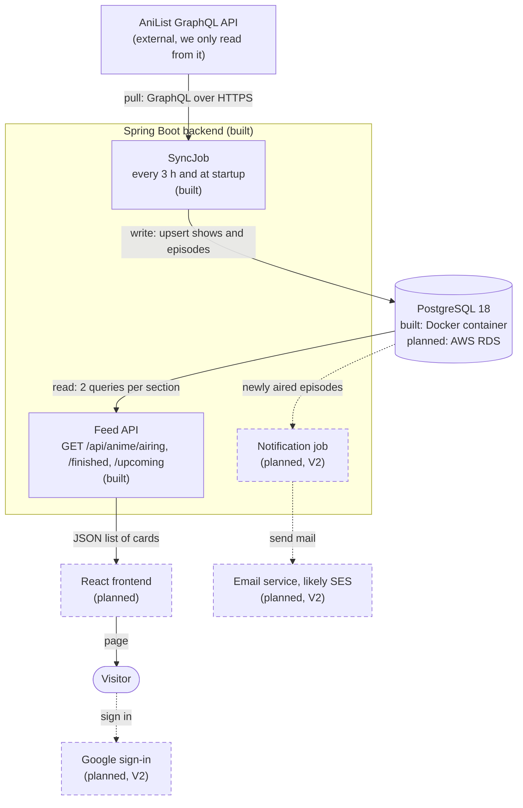
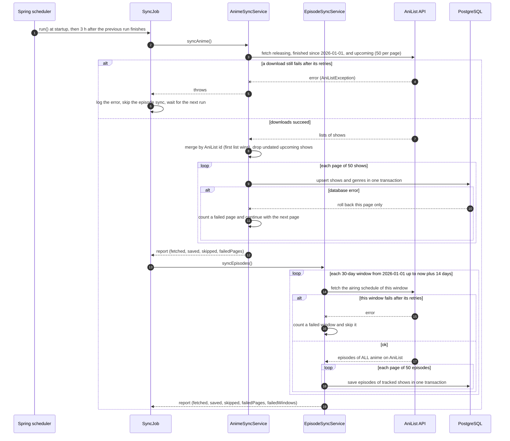
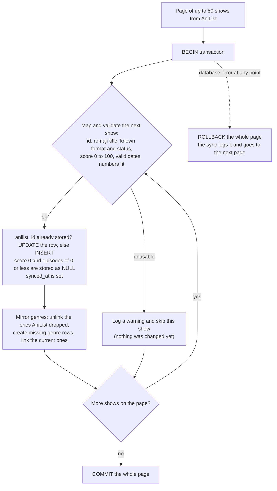
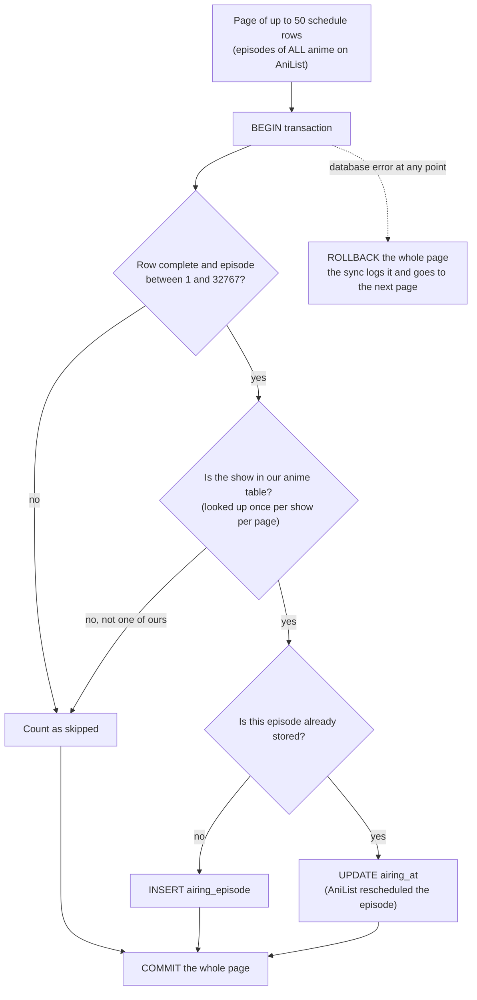
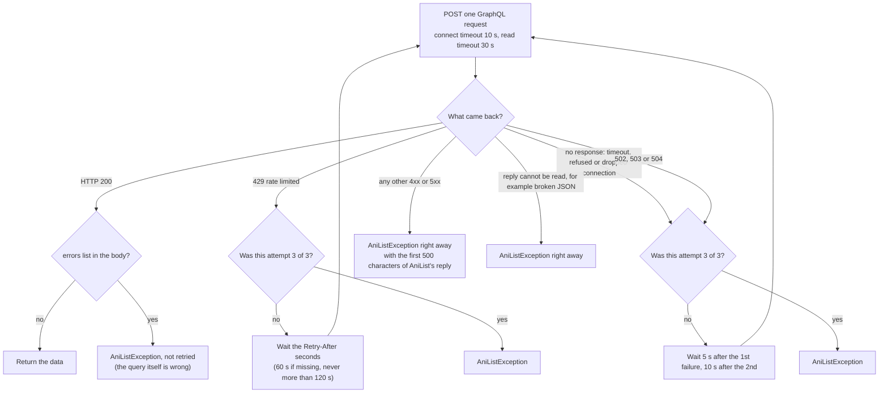
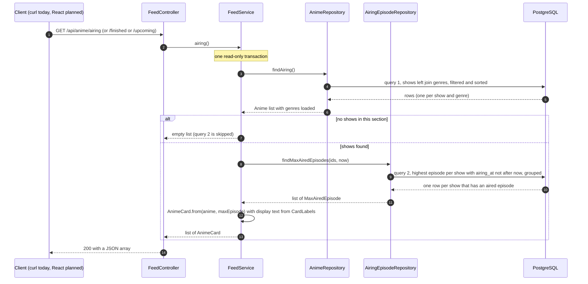
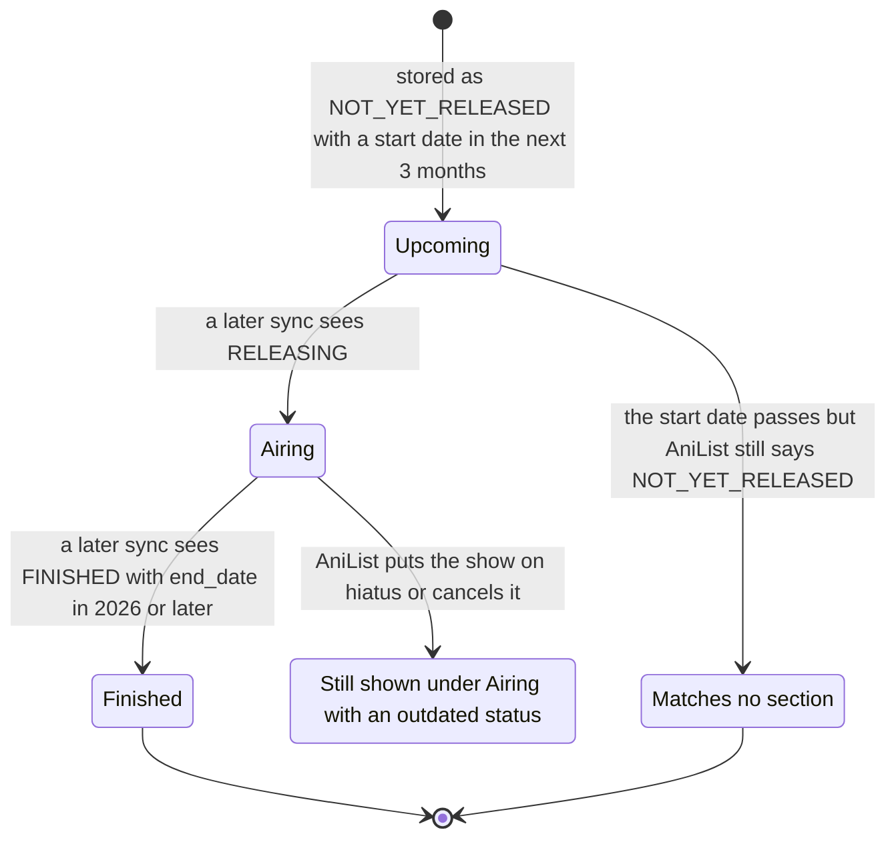
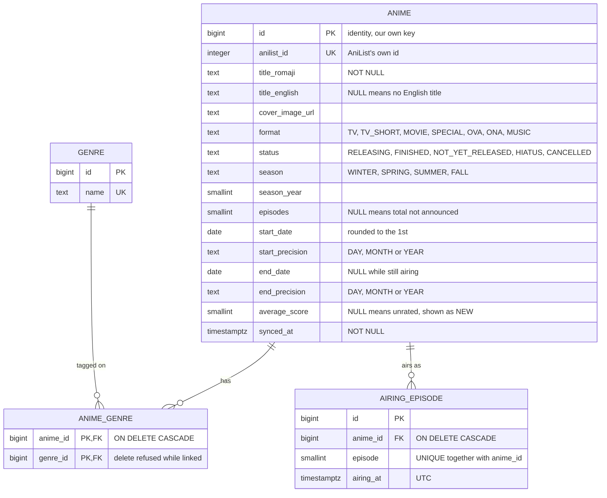

# Data flow

Each section has one diagram and a short explanation of what it shows and why it is shaped that way. Status words: **built** = in `main` and run, **planned** = not written yet (dashed in the diagrams). See [`README.md`](./README.md) for how to keep this file honest.

Contents: [1. System overview](#1-system-overview) · [2. The sync run](#2-the-sync-run) · [3. Saving one page](#3-saving-one-page) · [4. One AniList request](#4-one-anilist-request-and-its-retries) · [5. One feed request](#5-one-feed-request) · [6. Feed sections over time](#6-how-a-show-moves-between-feed-sections) · [7. Data model](#7-data-model) · [8. Who reads and writes what](#8-who-reads-and-writes-what) · [9. When things fail](#9-when-things-fail) · [10. Known gaps](#10-known-gaps)

---

## 1. System overview

**What it shows.** Data moves in one direction: from AniList, through the sync job, into our own Postgres, and out through a read-only API. A visitor's request never reaches AniList.

**Why it is shaped this way.** The sync job is the only writer, and the feed API only reads. That gives fast, indexed reads from our own database, keeps us far below AniList's rate limits, and means the site still shows data when AniList is down. The cost is that data can be up to about 3 hours old (the job waits 3 hours after each run finishes).

**Built vs planned.** The whole backend path from AniList to the three JSON endpoints is built and was run against the real AniList and a real Postgres. Nothing exists yet for the frontend, the AWS deployment, or any of V2. Today the database is a Docker container started from `docker-compose.yml`, with credentials in the gitignored `.env`.

---

## 2. The sync run

**What it shows.** One run of the job: first the shows, then their episodes. Each download is broken into small steps, and each save is a short transaction, so a failure costs a small piece and never the whole run.

**Why it is shaped this way.**
- **Shows before episodes**, because an episode row needs its show (`airing_episode.anime_id` is a foreign key). If the show download fails, the episode sync is skipped, since there is nothing safe to attach episodes to. The next run catches up.
- **Windows of 30 days**, because AniList refuses more than 5,000 entries per query and the whole year is more than that. Each window is below the cap and is independent, so one bad month does not discard the rest.
- **`fixedDelay`**: the next run starts 3 hours after the previous one finishes, so two runs can never overlap and write the same rows.
- **No transaction is open while waiting on the network.** The services only fetch and split. Each page is saved by a separate bean (`AnimePageSaver`, `AiringEpisodePageSaver`) so Spring's `@Transactional` proxy applies.
- A failed database save of a page does **not** throw out of the show sync, so a run with a few failed pages still goes on to the episode sync. Only a failed **download** skips it.

**Built.** All of it. The run is also what writes `synced_at`, and tests switch it off with `animeverse.sync.enabled=false` so tests never call AniList.

---

## 3. Saving one page

Two small diagrams, one per saver. Each page is up to 50 rows and is one database transaction: **all of it is saved, or none of it.** Like a bank transfer, where both the withdrawal and the deposit happen or neither does.

### 3a. A page of shows (`AnimePageSaver`)

**Why.** The mapper validates a show **before** it changes anything, so skipping one bad show inside the transaction cannot leave a half-written row. A real database error rolls back only that page of 50. Saving is an **upsert** (update if known, insert if new), so running the same page twice gives the same data and a retry never creates duplicates. The database backs this up with `UNIQUE (anilist_id)`.

### 3b. A page of episodes (`AiringEpisodePageSaver`)

**Why.** AniList's schedule covers every anime it knows, so most rows are for shows we do not store, and those are skipped. Rescheduled episodes are updated in place, and `UNIQUE (anime_id, episode)` makes duplicates impossible.

**Built.** Both savers, with unit and integration tests.

---

## 4. One AniList request and its retries

**What it shows.** What `AniListClient` does with one request. Every failure leaves as the same exception type (`AniListException`), so callers handle one thing. A long list is many such requests, one per page of 50, with a safety stop after 200 pages.

**Why it is shaped this way.** Retry only what can change. A timeout or a 503 may work a few seconds later, so those wait and retry (exponential backoff: the wait doubles, like waiting longer before redialing a busy line, so we do not hammer a struggling server). A 400 for a bad query would fail the same way forever, so it fails immediately. Retrying is safe because these requests only **read** data, so a repeat cannot create duplicates. There are at most **3 attempts in total**, so at most 2 waits and none after the last try.

**Built.** Verified with 15 tests against a fake AniList server (no real waiting), and against the real AniList once.

---

## 5. One feed request

**What it shows.** The only read path in the system. The controller only maps a URL to a service call. The service runs **exactly two SQL statements per section, however many cards there are**, then turns each row into an `AnimeCard` (a DTO, the shape promised to the frontend) with the display text already prepared ("Ep 4 / 12", "Fall 2026", "Oct 4, 2026").

**Why it is shaped this way.**
- **Two queries, not one per card.** Fetching each show's genres and latest episode one by one is the N+1 problem: 1 query for the list plus 1 per card, so 60 cards would cost 121 queries. `left join fetch` loads shows with their genres in one query, and one grouped query answers "latest aired episode" for all shows at once. `FeedQueryCountTest` fails if this ever slips, and it includes a deliberate N+1 to prove the counter works.
- **`Ep X` is the MAX aired episode, not a count**, because only this year's episodes are stored, so counting would show One Piece as "Ep 40".
- **Three endpoints**, so one failing does not affect the others and the frontend can render each section as it arrives.
- **A DTO, not the entity**, so internal fields (`anilistId`, `syncedAt`) never leave the backend. A test asserts they are absent from the JSON.
- **No pagination** in V1 (at most about 240 KB of JSON per section, an estimate). `join fetch` on a collection would force in-memory paging, so adding pagination later means changing the query approach.

**Built.** Verified by tests and by `curl` against real data: 217 airing, 436 finished and 163 upcoming shows when last checked.

---

## 6. How a show moves between feed sections

The database rows change over time as the sync overwrites `status` with what AniList currently says. This shows which section a show is in, and where the design leaks.

**What it shows.** A show is placed by its `status` (and dates), so it moves **only when a sync runs**, never when a visitor opens a page.
- **Upcoming:** `NOT_YET_RELEASED`, start date from today up to 3 months ahead, soonest first.
- **Airing:** `RELEASING`, newest premiere first (shows with no date last).
- **Finished:** `FINISHED` with `end_date` on or after 2026-01-01, most recently ended first.

**Where it leaks (both are known limits, not built fixes).**
- AniList's `RELEASING` filter stops returning a show that goes on hiatus or is cancelled, so its stored row never updates and it stays under **Airing**. V1 accepts this. V2's hiatus and cancellation emails will need a way to re-check shows we already have.
- A show stuck as `NOT_YET_RELEASED` whose start date is in the past matches no query, so it disappears from every section.

`HIATUS` and `CANCELLED` are allowed in the schema but nothing in V1 fetches or shows them.

---

## 7. Data model

**What it shows.** The four V1 tables, all **built** (`V1__create_v1_schema.sql`, applied by Flyway). `ANIME_GENRE` is the join table that makes the many-to-many between shows and genres: one row per link.

**Why it is shaped this way.**
- **Own `id`, separate `anilist_id`**, so the database is not tied to AniList's numbering.
- **Partial dates** are a `date` plus a precision, because AniList often knows only a month or a year. The display stays honest ("April 2027", not "April 1"). A `CHECK` makes the date and its precision both present or both missing.
- **`NULL` means unknown**, never a made-up value: no score shows a NEW badge, no episode total shows "?".
- **`ON DELETE CASCADE`** from `anime`, because genre links and episodes mean nothing without their show. A genre still linked to a show cannot be deleted.
- **The database is the last line of defense.** Types and `CHECK` rules apply to every write, so a score of 140 or a status typo can never be stored whatever code writes it.
- **Indexes** match the feed: `(status, start_date DESC)` and `(status, end_date DESC)` for the sections, `airing_at` for V2's "what aired since the last check", and `anime_genre(genre_id)` for lookups by genre. Postgres does not index foreign keys on its own.
- **Flyway owns the schema** and Hibernate only validates it (`ddl-auto=validate`). A migration is never edited after it has run. Changes go in a new `V2__` file.

**Planned, not designed yet:** V2 tables for users, follows and sent notifications. The idea on record is a sent-notifications table with a unique (user, anime, episode) constraint so an email is never sent twice. The names and columns are not decided, so they are not drawn.

---

## 8. Who reads and writes what

| Data | Written by | Read by | Notes |
|---|---|---|---|
| `anime`, `genre`, `anime_genre` | `AnimePageSaver`, called only by the sync job | `FeedService` through `AnimeRepository` | No API endpoint writes anything. |
| `airing_episode` | `AiringEpisodePageSaver`, called only by the sync job | `FeedService` (highest aired episode). V2 notifications (planned) | |
| Schema (tables, indexes) | Flyway, at app startup | Hibernate checks it with `validate` | `flyway_schema_history` records what ran. |
| AniList data | AniList (external) | `AniListClient` over HTTPS | Read-only for us. No AniList account or key is used. |
| Database credentials | You, in the root `.env` (gitignored) | Docker Compose and Spring | Never committed. No `.env.example` by decision. |
| Feed JSON | `FeedController` | Anyone who can reach the server | See access below. |

**Access today (built):**
- The API has **only three `GET` routes**, no write endpoint, and **no authentication**. There is no Spring Security in the project. That is fine for public, read-only news data in V1. V2's sign-in will need it.
- The app uses **one database user** for migrations and for queries. There is no separate read-only role.
- It is **not deployed**. In development, Postgres is published on the laptop's port 5432.
- There is **no CORS configuration**. A browser blocks a page on another origin (for example a React dev server) from calling the API, so the frontend branch must settle this, for example with a dev proxy or a CORS setting. This is a decision still to make, not made here.

---

## 9. When things fail

| What fails | What happens | Where it is handled |
|---|---|---|
| AniList is slow, drops the connection or answers 502/503/504 | Retried up to 3 attempts in total, waiting 5 s then 10 s, then `AniListException`. | `AniListClient` |
| AniList rate limit (429) | Waits the `Retry-After` seconds (default 60 s, capped at 120 s), up to 3 attempts. | `AniListClient` |
| AniList answers a bad query or other error (400, 500, broken JSON) | Fails right away with AniList's own message. Retrying would not change the result. | `AniListClient` |
| The show download fails | Logged. Episode sync is skipped this run. The feed keeps serving the last saved data. Next run is in 3 hours. | `SyncJob` |
| One show is unusable (no title, unknown format, score out of range) | Logged and skipped. The rest of the page is saved. | `AnimeMapper`, `AnimePageSaver` |
| A database error while saving a page | That page of 50 is rolled back, counted in `failedPages`, and the next page continues. The next run saves it again. | `AnimeSyncService`, `EpisodeSyncService` |
| One 30-day episode window fails to download | Logged, counted in `failedWindows`, skipped. The other windows still run. | `EpisodeSyncService` |
| The sync runs again over the same data | Safe. Saves are upserts, and `UNIQUE (anilist_id)` and `UNIQUE (anime_id, episode)` stop duplicates. | `AnimePageSaver`, schema |
| A sync takes very long | The next run waits for it to finish, so runs never overlap. | `@Scheduled(fixedDelay)` |
| AniList is down while visitors browse | No effect. The feed reads only our database. | Architecture |
| Postgres is down during a feed request | The exception is not caught anywhere, so Spring's default error response (HTTP 500) is returned. | Not handled on purpose yet, see gaps |
| Tests | The sync is switched off, so tests never call AniList or write to the real database. | `src/test/resources/config/application.properties` |

---

## 10. Known gaps

Things that are true today and would surprise a reader of the diagrams. Each is recorded in [`../LOG.md`](../LOG.md) under "Decisions & Open Questions" or is a finding from checking the code.

- `YEAR_START` is hard-coded to 2026-01-01, so in 2027 "Finished this year" keeps growing instead of resetting.
- Shows that go on hiatus or are cancelled, and shows stuck as "not yet released" past their start date, are handled as described in section 6.
- `synced_at` is set on every row on every sync, so every row counts as changed and gets an `UPDATE`.
- Nothing stores or exposes whether the last sync worked. The only record is the log, and the API does not show how fresh the data is.
- No custom error handler and no CORS configuration (section 8).
- The episode sync downloads the schedule of every anime on AniList and keeps only ours. It is the slowest part. Asking AniList only for our shows (`mediaId_in`) is the noted option if it becomes a problem.
- Many shows have no English title, so the React card must fall back to the romaji title.
